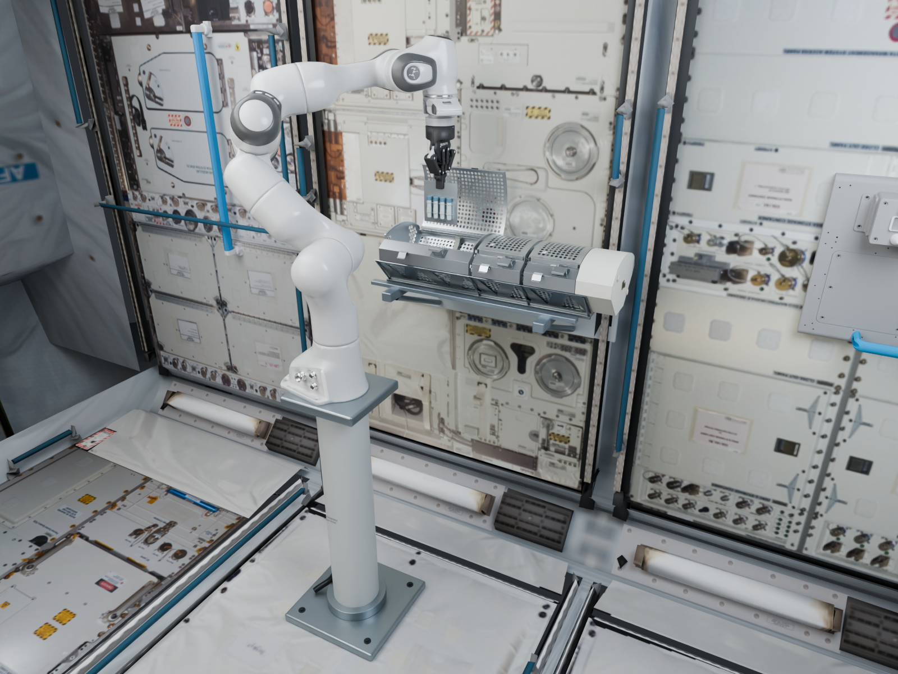
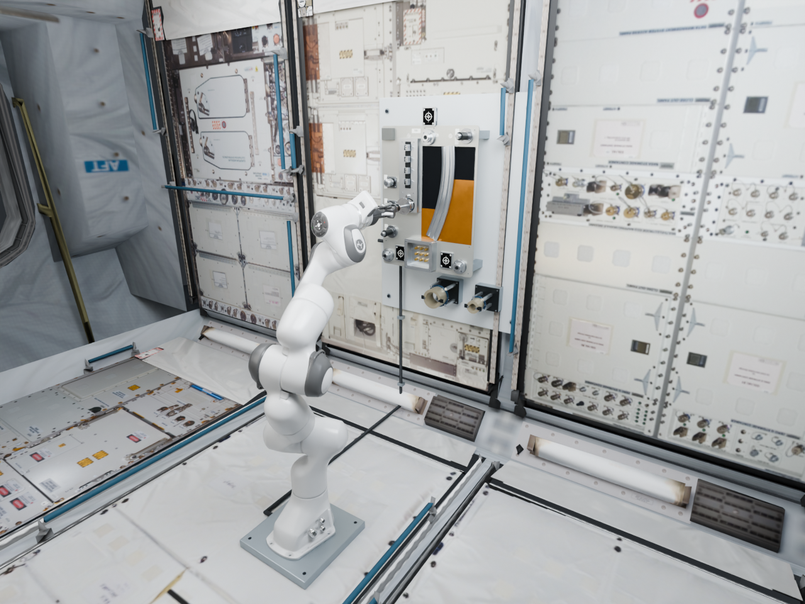
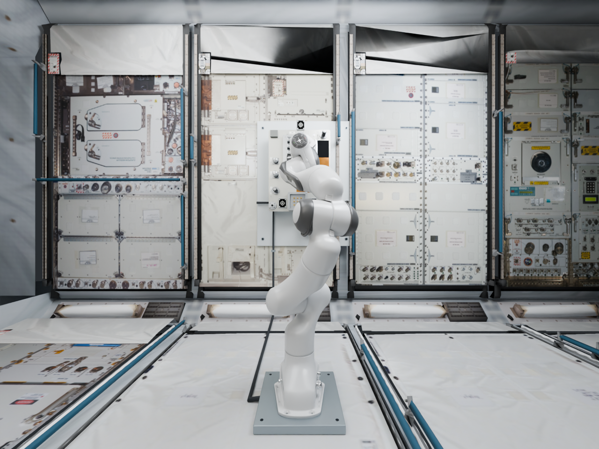
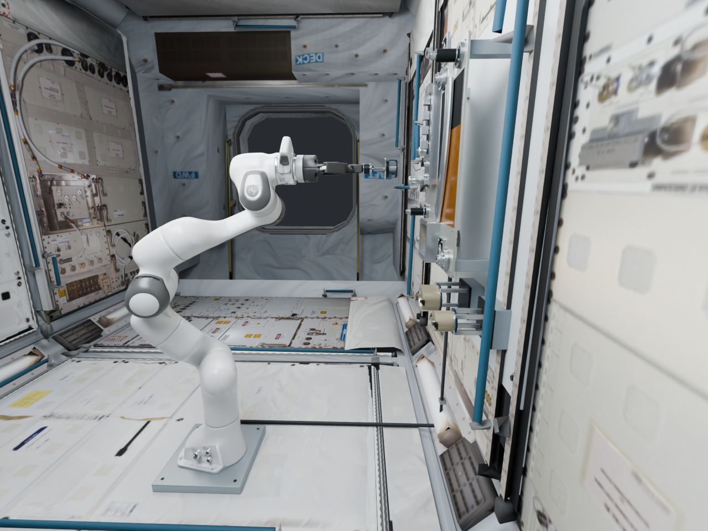

# 太空操作工作位

[English](workcells.md) · [简体中文](workcells.zh-CN.md) · [返回 README](../README.zh-CN.md)

AstroBench 提供两组包含可编辑硬件、独立运动部件和明确完成目标的操作工作位。MELFI V6 面向空间站舱内样本收纳；RRM TB1 面向壁挂维修面板上的接口帽与防脱螺钉维护。两组均采用固定机械臂基座和零重力，设备由安装支架固定。

| MELFI V6 | RRM TB1 |
| :---: | :---: |
|  |  |
| [GLB](../assets/workcells/melfi_v6/melfi_v6.glb) · [Blender](../assets/workcells/melfi_v6/melfi_v6.blend) · [部件清单](../assets/workcells/melfi_v6/parts.json) | [GLB](../assets/workcells/rrm_tb1/rrm_tb1.glb) · [Blender](../assets/workcells/rrm_tb1/rrm_tb1.blend) · [部件清单](../assets/workcells/rrm_tb1/parts.json) |

## 生成可复现的评测计划

克隆仓库并安装 Python 包后，在仓库目录执行以下命令。模型保存在仓库中；Python 包提供任务目录、计划生成与评分功能。

```bash
astrobench workcells --output workcells.json
astrobench workcell-check-assets assets/workcells --output asset-check.json
astrobench workcell-plan --workcell all --repeats 10 --seed 42 \
  --asset-root assets/workcells --output workcell-plan.json
```

共 **9 项任务定义、29 个任务与目标组合**：MELFI 15 个，RRM 14 个。每个组合重复 10 次，对应 290 个回合。`--workcell melfi_v6` 只选择 MELFI，`--workcell rrm_tb1` 只选择 RRM。也可使用 `--task` 选择具体任务；仅选择一项任务时，可用 `--target` 指定某个盒子、接口帽或螺钉：

```bash
astrobench workcell-plan --workcell rrm_tb1 --task sma_remove_stow --target SMA_2_2 \
  --repeats 10 --seed 42 --asset-root assets/workcells --output sma-plan.json
```

该示例为默认可动的 `SMA_2_2` 接口帽生成 10 个回合。重复传入 `--target` 可选择同一任务下的多个目标；省略时包含该任务的所有目标。其它 RRM 目标位置应先构建相应变体，评分时按下文传入对应资产目录。

`astrobench.workcell-plan/v2` 计划将任务、目标、初始状态、阈值、资产身份和语言指令绑定到回合 `spec_hash`。策略接收 `episode["spec"]["language_prompt"]["text"]`；该绑定同时保存语言注册表版本、注册表哈希与文本哈希。相同输入生成相同计划。每次重复都按记录的初态独立执行，计划与轨迹一同保留；输出文件采用独占创建，避免覆盖已有结果。

## 任务与目标

每项任务的英文指令与目标展开见[任务与 Prompt 目录](tasks.zh-CN.md)。按计划中的指令和 `target_id` 选择目标。

所有末态条件都要求在 **30 秒**回合的最后 **1 秒**持续成立。位置单位为米，角度为弧度，时间为秒，力为牛顿。下表用便于阅读的单位列出判据；完整参数见 [workcells.json](../astrobench/data/workcells.json)。

| 任务 ID | 每轮目标数 | 初始条件 | 完成条件 |
| --- | --- | --- | --- |
| `card_transfer_to_mouth` | 3 个盒子 | 卡片位于盒外，夹爪张开 | 抓持卡片并移至指定盒口，位置误差不超过 5 mm、姿态误差不超过 5°。 |
| `card_insert` | 3 个盒子 | 夹爪在指定盒外持有卡片 | 卡片整体进入有效容积，插入目标误差不超过 5 mm、5°；夹爪释放，实际固定力至少 0.01 N。 |
| `card_extract` | 3 个盒子 | 卡片已固定在指定盒内 | 抓持卡片，使其完全越过盒口且净空至少 20 mm，并保持在取出目标的 5 mm、5°以内。 |
| `lid_open` | 3 个盒子 | 盒盖关闭并锁定 | 释放锁扣，将指定盒盖打开至至少 75°。 |
| `lid_close` | 3 个盒子 | 盒盖打开至 85° | 合盖至 3°以内，锁扣闭合且啮合，工具退出至少 50 mm。 |
| `fdv1_remove_stow` | FDV1 | 接口帽旋紧在座 | 旋松并退出至少 60 mm，由适配器保持接口帽，归存并退出驱动工具。 |
| `sma_remove_stow` | 9 个 SMA 位置 | 指定接口帽旋紧在座 | 旋松指定帽并退出至少 35 mm，由适配器保持，归存并退出驱动工具。 |
| `captive_loosen` | 2 个螺钉 | 螺钉已旋紧 | 旋松至少 2.8 圈，轴向位移达到 1.8–3 mm，螺钉仍处于防脱约束中。 |
| `captive_tighten` | 2 个螺钉 | 螺钉旋松 3 圈、抬升 2.1 mm | 回到距旋紧状态 0.12 rad、0.15 mm 以内，保持防脱，工具脱离并退出。 |

MELFI 目标 ID 为 `Front_quarter_box`、`Middle_quarter_box`、`Rear_half_box`。RRM 目标 ID 为 `FDV1`、`SMA_1_1` 至 `SMA_3_3`、`captive_1` 和 `captive_2`。完成目标必须与回合指定的盒子、接口帽或螺钉一致。

卡片任务还要求线速度不超过 20 mm/s、角速度不超过 0.2 rad/s。拆帽任务在归存前检查帽与适配器的保持关系：相对位置误差不超过 3 mm、姿态误差不超过 3°、相对线速度不超过 10 mm/s、相对角速度不超过 0.1 rad/s，接触力至少 0.01 N。最终归存还要求适配器距归存目标不超过 2 mm、两侧锁扣闭合、法兰被捕获、存在支撑接触、驱动工具脱离并退出超过 100 mm，帽的运动已稳定。仅接触或提起接口帽不能完成拆帽归存任务。

## 模型与安装布置

### MELFI V6

托盘采用 ESA MELFI 资料中的“两窄一宽”组合：两个四分之一盒外包络为 220 × 130 × 143 mm，一个半盒为 220 × 270 × 143 mm。样本卡尺寸为 100 × 110 × 2 mm，上方保留 25 mm 抓持区。弧形穿孔盖、铰链、独立的盒盖锁与托盘锁、保温结构、样本约束均分为独立部件。

托盘平行于墙面安装，机械臂由前方地面支柱支撑，盒口朝向操作空间。模型保留安装支架和机械臂基座坐标，便于不同运行保持一致布置。

### RRM TB1

面板包括 FDV1 第三级保护帽、3 × 3 SMA 帽阵列和两个防脱螺钉位置。r003 布局将面板竖直固定在舱壁上，机械臂安装在正前方地面的薄底板上，自然展开后面向面板中央；归存座位于接口区下方。使用任务与工具坐标系，将工具轴线对准面板法向。

| 正面 | 侧面 |
| :---: | :---: |
|  |  |

面板坐标原点高出舱内地面 **983.45 mm**；机械臂基座位于面板前方 **690 mm**，安装面高出地面 **28 mm**。待操作位姿的工具尖端位于面板中央前方 **120 mm**。这些尺寸定义工作位安装关系，接入时使用 manifest 中的安装变换。

| 接口 | 工具组合 | 操作方式 |
| --- | --- | --- |
| FDV1 第三级保护帽 | 多功能工具 MFT + 第三级帽适配器 TCA | 捕获接口帽、旋松、轴向退出，随后将适配器与帽一同归存。 |
| SMA 帽 | 安全帽工具 SCT + SMA 适配器 | 对准指定接口帽，旋松并退出，将适配器与帽一同归存。 |
| 防脱螺钉 | 安全帽工具 SCT + #10 Torque Set 适配器 | 工具啮合后旋转，松紧过程中螺钉始终保持在防脱机构内。 |

任务资产包含工件、工具和支撑结构。通过各工作位 manifest 中的 `robot_attachment_frames` 接入自己的机械臂与舱体资产。`parts.json` 记录模型坐标及节点映射；应使用这些变换，而不是从截图估计比例或方向。GLB 导出遵循 glTF 坐标约定，Blender 文件与任务元数据使用已记录的资产坐标系。

两组资产均附碰撞描述和网格压缩包：[MELFI 碰撞几何](../assets/workcells/melfi_v6/collision.json)、[RRM 碰撞几何](../assets/workcells/rrm_tb1/collision.json)。接入碰撞模型时，应保留通孔、导套、工具凹槽和保持机构的结构，整体凸包会改变这些配合关系。[资产目录](../assets/workcells/)中还包含文件哈希、部件映射、资料来源和重建源文件。原创模型及源文件采用 [Apache-2.0](../assets/workcells/LICENSE) 许可，来源说明见 [NOTICE](../assets/workcells/NOTICE)。

可先用 [Blender 加载器](../assets/workcells/load_asset.py)打开 r003 居中待操作布局，再保存具体任务初态：

```bash
blender -b -P assets/workcells/load_asset.py -- --asset rrm_tb1 \
  --ready --placement world --save outputs/rrm-ready.blend
```

```bash
blender -b -P assets/workcells/load_asset.py -- --asset melfi_v6 \
  --task card_extract --target Rear_half_box --save outputs/melfi-extract.blend
blender -b -P assets/workcells/load_asset.py -- --asset rrm_tb1 \
  --task sma_remove_stow --target SMA_2_2 --placement world --save outputs/rrm-sma.blend
```

该入口重置运动部件与工具位置。 每次任务重置先恢复资产坐标，再应用 `--placement world`，将重置后的 RRM 场景安装到壁挂与地面布局中。MELFI 转移、插入任务采用释放带形，取出任务采用绕卡保持带形。环境适配器根据随附端点约束及弹性参数实现 `runtime_elastic_strip`，再从实际接触测量保持力。重置入口提供几何初态，后续动力学与评分测量由适配器执行。

### 选择其它 RRM 接口帽或螺钉

默认 RRM 模型的可动目标为 `FDV1`、`SMA_2_2` 和 `captive_1`；源文件支持九个 SMA 位置及两个防脱螺钉。例如，在独立目录构建第 1 行第 3 列 SMA 帽和第 2 个防脱螺钉，再加载指定目标：

```bash
blender -b -P assets/workcells/publicbuild.py -- --asset rrm_tb1 \
  --sma-row 1 --sma-col 3 --captive-index 2 --output-root outputs/rrm-variant
blender -b -P assets/workcells/load_asset.py -- --asset-root outputs/rrm-variant \
  --asset rrm_tb1 --task sma_remove_stow --target SMA_1_3 --placement world \
  --save outputs/rrm-sma-1-3.blend
astrobench workcell-score workcell-plan.json EPISODE_ID trace.json \
  --asset-root outputs/rrm-variant --output sma-1-3-result.json
```

使用原完整计划中 `SMA_1_3` 对应的回合 ID，以及该模型版本上测得的轨迹。输出目录包含两组工作位、源文件哈希，以及记录构建参数和原始 manifest 标识的新 manifest。评分时检查源文件是否与登记版本一致、指定目标是否处于可动状态，并在结果中记录实际资产标识。回合继续保留原计划标识，因此全部 29 个目标组合可以统一汇总。重置、碰撞网格解包和重建方法详见[资产指南](../assets/workcells/README.md)。

## 将测量状态接入评分

评分器接收环境适配器记录的状态。导入对应模型，安装机械臂，建立任务关节与约束，按计划中的 `initial_state` 重置，再连续记录同步测量。应记录物体的实际状态，不能用关节指令、规划位姿或统一的“抓取成功”标志替代。

每帧均包含 `t_s`、`measurement_time_s`、`target_id`、`linear_velocity_m_s`、`angular_velocity_rad_s`、`forbidden_contact` 和 `escaped`。两个时间戳必须一致。采样从 **0 秒**开始，到 **30 秒**结束，相邻帧间隔不超过 **25 ms**。按计划规定的初始几何与测量容差检查首帧实测状态。四元数使用 **w、x、y、z** 顺序且为单位四元数，向量与标量均采用 SI 单位。每帧字段须与对应任务定义完全一致。

| 任务组 | 额外测量字段 |
| --- | --- |
| 卡片转移 / 插入 / 取出 | `goal_relative_position_m`、`goal_relative_quat_wxyz`、`gripper_aperture_m`、`gripper_target_contact_force_n`、`object_released`、`retention_force_n`、`min_containment_margin_m`、`opening_clearance_m` |
| 开盖 / 关盖 | `lid_angle_rad`、`lid_latch_closed`、`lid_latch_engaged`、`driver_clearance_m` |
| FDV1 / SMA | `fastener_angle_rad`、`fastener_axial_m`、`thread_engaged`、`cap_adapter_position_m`、`cap_adapter_quat_wxyz`、`cap_adapter_linear_velocity_m_s`、`cap_adapter_angular_velocity_rad_s`、`cap_retention_force_n`、`adapter_goal_position_m`、`adapter_goal_quat_wxyz`、`receiver_support_force_n`、`receiver_latch_positions_m`、`receiver_flange_captured`、`driver_attached`、`driver_clearance_m` |
| 防脱螺钉松 / 紧 | `fastener_angle_rad`、`fastener_axial_m`、`object_released`、`driver_attached`、`driver_clearance_m` |

容纳余量和盒口净空针对**整个卡片网格**测量，不能只检查中心点。螺钉角度为累积转角，不对 2π 取模。锁扣与释放字段描述实际关节和几何状态；`receiver_latch_positions_m` 是两侧锁扣相对关闭位置的实际偏移。公共速度字段在固定的资产 / 世界坐标系中测量。`cap_adapter_position_m` 与 `cap_adapter_quat_wxyz` 表示相对标称帽—适配器保持变换的误差，不能直接使用两个物体原点之间的距离。Python API 可返回确切字段与数据形状：

```python
from astrobench.workcells import workcell_trace_fields

fields = workcell_trace_fields("fdv1_remove_stow")
```

计算接口帽保持误差时，使用语义映射中的 `adapter_object` 和 `nominal_retained_cap_in_adapter`：`inverse(nominal) @ inverse(world_from_adapter) @ world_from_cap`。适配器对应可脱离的旋转部件，`driver_object` 对应归存后退出的驱动壳体；驱动器脱开后，仍应相对适配器测量接口帽状态。

`adapter_goal_*` 的归存目标取自 RRM `collision.json` 中的 `tasks.fdv1.stowage.tool_pose_panel` 或 `tasks.sma.stowage.tool_pose_panel`。二者旋转均为单位矩阵，在面板坐标系中的平移分别为 `[0.06, -0.36, 0.016]`、`[0.23, -0.36, 0.016]` 米。语义字段 `goal_frame_asset.target` 则表示接口帽的初始座位。

拆帽任务的 `driver_attached` 表示驱动器与适配器旋转部件之间的联接：初态为已联接、`driver_clearance_m: 0`，归存后脱开。防脱螺钉任务中，该字段表示刀头与螺钉的接合：初态未接合、间隙 100 mm。应按各任务的接口关系测量。

轨迹外层记录被冻结回合的标识：

```json
{
  "episode_id": "COPY_FROM_PLAN",
  "spec_hash": "COPY_FROM_PLAN",
  "samples": []
}
```

将空列表替换为适配器的完整测量序列，并按上述字段规范构造每帧；此外层格式本身不是可评分回合。

```bash
astrobench workcell-score workcell-plan.json EPISODE_ID trace.json \
  --asset-root assets/workcells --output episode-result.json
astrobench workcell-report workcell-plan.json results.json \
  --output workcell-report.json
```

`--asset-root` 应指向实际使用的模型目录；RRM 重建目标改用前述变体目录。对应的 Python API 为 `astrobench.workcells` 中的 `resolve_workcell_episode(episode, asset_root=...)` 与 `score_workcell_trace(episode, samples, asset_root=...)`。前者检查目标可动状态与已登记源文件，评分则保留原计划回合标识，并记录 `evaluated_asset_manifest_sha256`、`evaluated_binding`、`evaluated_asset_provenance`。

`results.json` 为逐回合结果对象组成的数组。结果包含阶段进展、失败原因、末态保持时长和轨迹校验值。实际完成测量但任务未成功，记为已完成评测且 `strict_success: false`；不合规的轨迹记为 `status: invalid`、`strict_success: null`。报告按任务及目标分组，保留运行错误和尚未执行的回合，分别给出已完成回合中的成功率及成功回合占全部计划的比例；所有计划回合都有有效完成结果后，才生成 `full_plan_success_rate`。请同时保留计划、轨迹、逐回合结果和汇总文件。

## 真实参考与已有检查

NASA / ESA 资料用于确定可见外形、尺寸和操作流程；机器人布置、工具内部机构及评分容差由 AstroBench 设计。“两窄一宽”MELFI 组合见 ESA 2002 年资料，NASA 2015 年接口文件记录了此后逐步取消四分之一盒的变化。MELFI V6 已完成 26 个卡片转移动作位姿的几何检查，终点为盒口。下列三条视频记录原水平工作台布局的 RRM 脚本功能试跑，分别覆盖 FDV1 拆帽归存、中央 SMA 帽拆帽归存，以及一个防脱螺钉的松紧循环；其中工具局部接触检查和机械臂几何检查，与 29 个任务目标组合及本版评分协议分别记录。

r003 壁挂布局另完成 335 个 CAD / 逆运动学姿态检查：1 个居中待操作姿态、226 个转换后的机构轨迹姿态，以及全部 12 个操作目标的 108 个接近 / 退出姿态。采样姿态中未发现地面、舱壁、自身或工具与臂之间的非任务碰撞；这组记录属于布局检查，三条视频保留其原机构试跑含义。

[▶ FDV1 试跑](media/fdv1.mp4) · [▶ SMA 试跑](media/sma.mp4) · [▶ 防脱螺钉试跑](media/captive.mp4)

## 官方资料

| 来源 | 对应内容 |
| --- | --- |
| [ESA Bulletin 109 — MELFI（2002）](https://www.esa.int/esapub/bulletin/bullet109/chapter5_bul109.pdf) | 印刷页 40–41 / PDF 第 6–7 页：两窄一宽组合、样本卡及弹性固定带。 |
| [NASA SSP 57000 Rev. R（2015）](https://ntrs.nasa.gov/api/citations/20190001390/downloads/20190001390.pdf#page=327) | 附录 H，H-30–H-32：置物盒操作、锁扣、尺寸和图纸。 |
| [NASA — Rick Mastracchio Replaces Science Freezer Tray](https://www.nasa.gov/image-article/rick-mastracchio-replaces-science-freezer-tray/) | 在轨 MELFI 托盘操作照片。 |
| [NASA — RRM 热设计论文（2011）](https://ntrs.nasa.gov/api/citations/20110013452/downloads/20110013452.pdf#page=3) | 任务板布局、接口帽与螺钉分组、工具外形。 |
| [NASA — RRM Phase 1](https://www.nasa.gov/nexis/rrm-phase-1/) | 工具分工与 RRM 维护操作流程。 |
| [NASA — Refueling Demonstration Proves Viability（2013-02-08）](https://www.nasa.gov/news-release/nasas-refueling-demonstration-proves-viability-of-satellite-servicing-technologies/) | RRM 任务中已完成的机器人拆帽与归存。 |
| [NASA ISS Daily Summary（2013-05-03）](https://www.nasa.gov/blogs/stationreport/2013/05/03/iss-daily-summary-report-05-03-13/) | 使用 SMA 适配器和归存座操作接口帽的当日计划。 |
| [NASA ISS Daily Summary（2013-05-07）](https://www.nasa.gov/blogs/stationreport/2013/05/07/iss-daily-summary-report-05-07-13/) | 使用 #10 Torque Set 适配器完成螺钉旋紧的记录。 |

